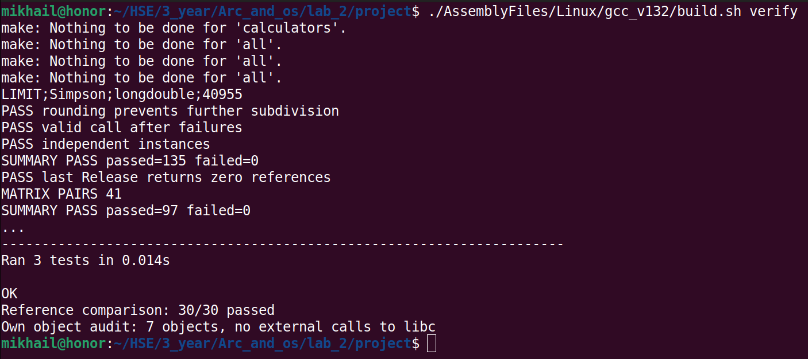

# Лабораторная работа №2 — включение и агрегирование ACOM

Автор: Михаил Сибиряков, группа 24ТИДИ.

## EcoIntegralSimpson и EcoLab2

Компонент первой работы дополнен арифметическими интерфейсами и поддержкой
агрегирования. Создан внешний компонент EcoLab2:

- EcoIntegralSimpson включает калькуляторы A и D.
- EcoLab2 включает C и E, агрегирует EcoIntegralSimpson и предоставляет его интерфейс интегрирования.
- Внутри D используется включение B, внутри E — агрегирование отдельного B.

`IEcoCalculatorX` предоставляет сложение и вычитание, `IEcoCalculatorY` —
умножение и деление. Новый `IEcoLab2` содержит метод `Calculate` для четырёх операций.
Алгоритм Симпсона и публичный `IEcoAdvancedMath` первой работы сохранены.

## Структура проекта

~~~text
Components/
├── EcoIntegralSimpson/           # компонент первой работы с доработками
└── Eco.Lab2/                     # новый внешний компонент
DependenciesFiles/InsideACOM/     # учебные калькуляторы A–E
UnitTestFiles/                   # клиент второй работы и общие проверки
AssemblyFiles/                   # общая сборка
BuildFiles/                      # библиотеки, клиенты и журналы проверок
~~~

В каждом компоненте `SourceFiles` содержит реализацию, `HeaderFiles` — внутренние
структуры, `SharedFiles` — публичные интерфейсы и идентификаторы, `AssemblyFiles` —
файлы сборки. Прежний тестовый клиент находится в
[проекте интегратора](Components/EcoIntegralSimpson/UnitTestFiles/SourceFiles/EcoIntegralSimpson.c).

## Что изменено во второй работе

| Файлы | Назначение изменений |
|---|---|
| [CEcoIntegralSimpson.c](Components/EcoIntegralSimpson/SourceFiles/CEcoIntegralSimpson.c), [CEcoIntegralSimpson.h](Components/EcoIntegralSimpson/HeaderFiles/CEcoIntegralSimpson.h) | Доработаны: включение A/D, интерфейсы X/Y и поддержка агрегирования. |
| [CEcoIntegralSimpsonFactory.c](Components/EcoIntegralSimpson/SourceFiles/CEcoIntegralSimpsonFactory.c) | Доработана фабрика: создание интегратора с внешним управляющим Unknown. |
| [CEcoLab2.c](Components/Eco.Lab2/SourceFiles/CEcoLab2.c), [CEcoLab2Factory.c](Components/Eco.Lab2/SourceFiles/CEcoLab2Factory.c) | Новые: внешний компонент с C/E, агрегированным интегратором и методом Calculate. |
| [IEcoLab2.h](Components/Eco.Lab2/SharedFiles/IEcoLab2.h) | Новый публичный интерфейс Calculate. |
| [EcoLab2.c](UnitTestFiles/SourceFiles/EcoLab2.c) | Новый UnitTest: арифметика компонентов, B через D/E, переходы интерфейсов и время жизни агрегата. |
| [Lab2TestRegistration.c](UnitTestFiles/SourceFiles/Lab2TestRegistration.c) | Новый вспомогательный файл: регистрация фабрик A–E для обоих клиентов. |
| [DependenciesFiles/InsideACOM](DependenciesFiles/InsideACOM/) | Добавлены копии учебных A–E.

[EcoLab2_Report.pdf](EcoLab2_Report.pdf) — отчёт с описанием схемы, реализации и результатов.

## Сборка и тестирование

Нужны Linux x86_64, Eco.Framework в `~/Dev/Eco.Framework` и Eco toolchain
в `~/Dev/toolchain`. Для полной проверки также нужны Python 3, mpmath и binutils.

Из корня проекта:

~~~bash
./AssemblyFiles/Linux/gcc_v132/build.sh lab2-test
~~~

Команда собирает компоненты и запускает клиент второй лабораторной.
Успешный результат:

~~~text
MATRIX PAIRS 41
SUMMARY PASS passed=97 failed=0
~~~

Клиент содержит пять сценариев. Число 97 — количество проверяемых условий,
включая 41 переход между интерфейсами двух собственных компонентов.
Полный вывод клиента: `./AssemblyFiles/Linux/gcc_v132/build.sh lab2-run`.

Полная проверка обеих работ:

~~~bash
./AssemblyFiles/Linux/gcc_v132/build.sh verify
~~~

Дополнительно выполняются 135 прежних проверок интегратора, 30 сравнений
с mpmath и проверка отсутствия вызовов libc в собственном коде.

## Подтверждение запуска

Вывод полной проверки командой `build.sh verify`:

---

# Лабораторная работа №1 — задание 35

Автор: Михаил Сибиряков, группа 24ТИДИ.

## EcoIntegralSimpson

Компонент ACOM для вычисления определённого интеграла адаптивным методом
Симпсона. Реализован на языке C89 в структуре проекта, созданного Eco Wizard.

Интерфейс `IEcoAdvancedMath` содержит методы `integral`, `integralf`
и `integrall` для `double_t`, `float_t` и `long double` соответственно.
Подынтегральная функция передаётся как callback с необязательным контекстом.
Методы возвращают код статуса, а результат и оценку абсолютной погрешности
записывают в выходные параметры.

## Структура проекта

- [SharedFiles/IEcoAdvancedMath.h](Components/EcoIntegralSimpson/SharedFiles/IEcoAdvancedMath.h) — публичный интерфейс интегрирования.
- [SourceFiles/CEcoIntegralSimpson.c](Components/EcoIntegralSimpson/SourceFiles/CEcoIntegralSimpson.c) — реализация компонента и алгоритма.
- [SourceFiles/CEcoIntegralSimpsonFactory.c](Components/EcoIntegralSimpson/SourceFiles/CEcoIntegralSimpsonFactory.c) — фабрика ACOM.
- [UnitTestFiles/SourceFiles/EcoIntegralSimpson.c](Components/EcoIntegralSimpson/UnitTestFiles/SourceFiles/EcoIntegralSimpson.c) — консольный тестовый клиент.
- [UnitTestFiles/compare_reference.py](UnitTestFiles/compare_reference.py) — независимое сравнение с mpmath.
- [AssemblyFiles/Linux/gcc_v132/](Components/EcoIntegralSimpson/AssemblyFiles/Linux/gcc_v132/) — Makefile, скрипт сборки и конфигурация VS Code.
- [EcoLab1_Report.pdf](EcoLab1_Report.pdf) — отчёт с описанием метода, тестами и сравнительными таблицами.

## Сборка и тестирование

Необходимы Linux x86_64, установленный Eco.Framework, Eco GCC 13.2.0,
GNU make 4.4.1 и binutils.
Скрипт по умолчанию использует Framework в `~/Dev/Eco.Framework`
и инструменты в `~/Dev/toolchain`. Для другого расположения можно задать
переменные `ECO_FRAMEWORK` и `ECO_TOOLCHAIN`.

Из корня проекта:

~~~bash
./AssemblyFiles/Linux/gcc_v132/build.sh test
~~~

Команда собирает статическую библиотеку и запускает консольный UnitTest.
Успешный результат:

~~~text
SUMMARY PASS passed=135 failed=0
~~~

Проверяются три числовых типа, известные интегралы, адаптивность,
абсолютный и относительный допуски, равные и обратные границы,
неверные входные данные и сохранение выходов при ошибке.
Клиент регистрирует фабрику, получает компонент через `IEcoInterfaceBus1`
и вызывает методы `IEcoAdvancedMath`.

Для независимого сравнения нужны Python 3 и библиотека mpmath
(проверено с версией 1.3.0):

~~~bash
./AssemblyFiles/Linux/gcc_v132/build.sh verify
~~~

Помимо UnitTest команда выполняет сравнение с mpmath, вспомогательные тесты
скрипта сравнения и проверку собственных объектных файлов на вызовы libc.
Эталон вычисляется методом tanh-sinh при рабочей точности 50 десятичных знаков.
На десяти примерах для каждого типа проверяется абсолютная ошибка
не более `0.5 * 10^(-N)`: N = 4 для `float_t`, 8 для `double_t`,
10 для `long double`.

~~~text
Reference comparison: 30/30 passed
~~~

Результаты сборки находятся в `BuildFiles/Linux/x86_64/StaticRelease/`:
статическая библиотека `.a` и исполняемый клиент `EcoIntegralSimpson`.
Протокол тестов, CSV-таблица и сводка сравнения создаются в
`BuildFiles/verification/`. Результаты сборки и кеш Python исключены
из Git через `.gitignore`.

Для очистки результатов сборки:

~~~bash
./AssemblyFiles/Linux/gcc_v132/build.sh clean
~~~

## Подтверждение запуска

Для демонстрации используется вывод команды `build.sh verify`:
итог UnitTest `SUMMARY PASS passed=135 failed=0` и результат сравнения
`Reference comparison: 30/30 passed`.

