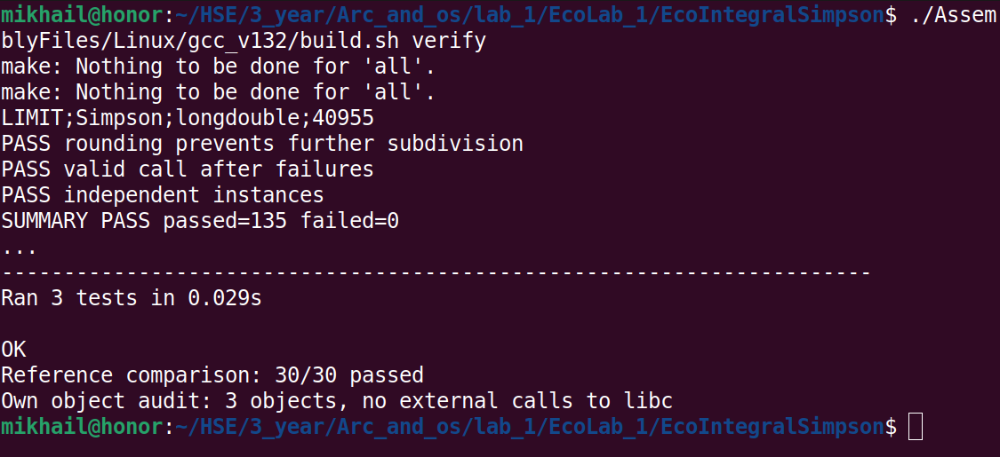

# Лабораторная работа №1 — задание 35

Автор: Михаил Сибиряков, группа 24ТИДИ.

## EcoIntegralSimpson

Компонент ACOM для вычисления определённого интеграла адаптивным методом
Симпсона. Реализован на языке C89 в структуре проекта, созданного Eco Wizard.

Интерфейс `IEcoAdvancedMath` содержит методы `integral`, `integralf`
и `integrall` для `double_t`, `float_t` и `long double` соответственно.
Подынтегральная функция передаётся как callback с необязательным контекстом.
Методы возвращают код статуса, а результат и оценку абсолютной погрешности
записывают в выходные параметры.

## Структура проекта

- [SharedFiles/IEcoAdvancedMath.h](SharedFiles/IEcoAdvancedMath.h) — публичный интерфейс интегрирования.
- [SourceFiles/CEcoIntegralSimpson.c](SourceFiles/CEcoIntegralSimpson.c) — реализация компонента и алгоритма.
- [SourceFiles/CEcoIntegralSimpsonFactory.c](SourceFiles/CEcoIntegralSimpsonFactory.c) — фабрика ACOM.
- [UnitTestFiles/SourceFiles/EcoIntegralSimpson.c](UnitTestFiles/SourceFiles/EcoIntegralSimpson.c) — консольный тестовый клиент.
- [UnitTestFiles/compare_reference.py](UnitTestFiles/compare_reference.py) — независимое сравнение с mpmath.
- [AssemblyFiles/Linux/gcc_v132/](AssemblyFiles/Linux/gcc_v132/) — Makefile, скрипт сборки и конфигурация VS Code.
- [EcoLab1_Report.pdf](EcoLab1_Report.pdf) — отчёт с описанием метода, тестами и сравнительными таблицами.

## Сборка и тестирование

Необходимы Linux x86_64, установленный Eco.Framework, Eco GCC 13.2.0,
GNU make 4.4.1 и binutils.
Скрипт по умолчанию использует Framework в `~/Dev/Eco.Framework`
и инструменты в `~/Dev/toolchain`. Для другого расположения можно задать
переменные `ECO_FRAMEWORK` и `ECO_TOOLCHAIN`.

Из корня проекта:

~~~bash
./AssemblyFiles/Linux/gcc_v132/build.sh test
~~~

Команда собирает статическую библиотеку и запускает консольный UnitTest.
Успешный результат:

~~~text
SUMMARY PASS passed=135 failed=0
~~~

Проверяются три числовых типа, известные интегралы, адаптивность,
абсолютный и относительный допуски, равные и обратные границы,
неверные входные данные и сохранение выходов при ошибке.
Клиент регистрирует фабрику, получает компонент через `IEcoInterfaceBus1`
и вызывает методы `IEcoAdvancedMath`.

Для независимого сравнения нужны Python 3 и библиотека mpmath
(проверено с версией 1.3.0):

~~~bash
./AssemblyFiles/Linux/gcc_v132/build.sh verify
~~~

Помимо UnitTest команда выполняет сравнение с mpmath, вспомогательные тесты
скрипта сравнения и проверку собственных объектных файлов на вызовы libc.
Эталон вычисляется методом tanh-sinh при рабочей точности 50 десятичных знаков.
На десяти примерах для каждого типа проверяется абсолютная ошибка
не более `0.5 * 10^(-N)`: N = 4 для `float_t`, 8 для `double_t`,
10 для `long double`.

~~~text
Reference comparison: 30/30 passed
~~~

Результаты сборки находятся в `BuildFiles/Linux/x86_64/StaticRelease/`:
статическая библиотека `.a` и исполняемый клиент `EcoIntegralSimpson`.
Протокол тестов, CSV-таблица и сводка сравнения создаются в
`BuildFiles/verification/`. Результаты сборки и кеш Python исключены
из Git через `.gitignore`.

Для очистки результатов сборки:

~~~bash
./AssemblyFiles/Linux/gcc_v132/build.sh clean
~~~

## Подтверждение запуска

Для демонстрации используется вывод команды `build.sh verify`:
итог UnitTest `SUMMARY PASS passed=135 failed=0` и результат сравнения
`Reference comparison: 30/30 passed`.

